# live-capture 文档

B 站直播弹幕 / SC / 礼物 / 动态采集服务，运行在手机 Termux 上，Flask 后端 + Vue 3 前端，数据落 SQLite，网页端管理与查阅。

## 预览

截图取自手机上正在跑的服务（400×860 视口），点开是原始尺寸。五个页面：仪表盘 / 数据 / 采集器 / 配置 / 日志，外加访问验证页；另有一个跟服务同口令的 `/sqlite/` 数据管理页（表浏览与编辑，未截图）。

### 访问验证

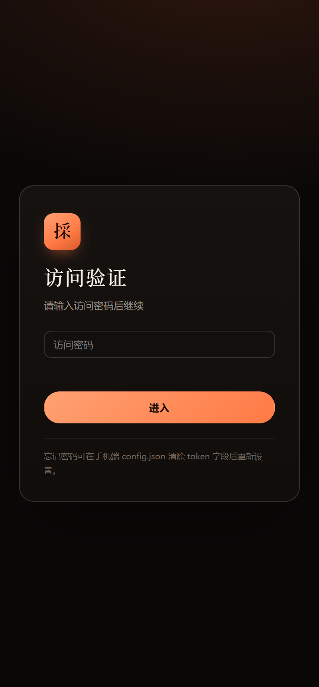

服务默认要口令才能进，防止同一局域网里谁都能翻记录。口令存在手机 `data/config.json` 的 `token` 字段，页面上的「清除访问码」会把它一起抹掉（等于关掉门禁）。

### 仪表盘

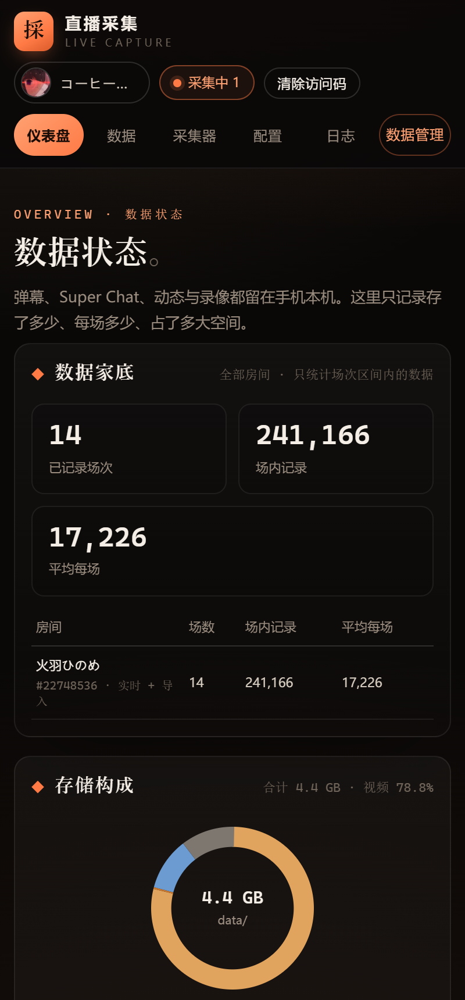

数据家底：总共记录了多少场、多少条、每场平均多少条，按房间分列。数字只统计场次区间内的记录，场间灌进来的零散弹幕不算在内。

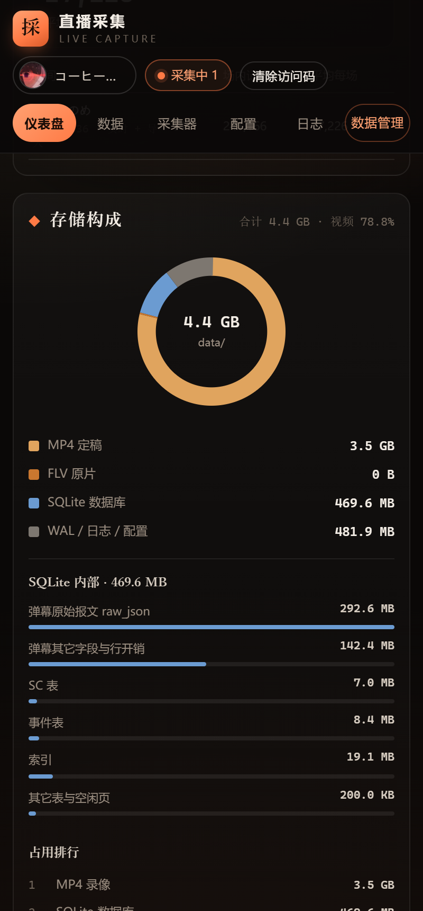

同一页往下是存储构成：MP4 定稿 / FLV 原片 / SQLite / WAL 与日志各自的体积，SQLite 内部再按 `raw_json`、其它字段、SC、事件、索引拆开，最后是占用排行。手机空间吃紧时先看这一块。

### 数据（回放与查阅）

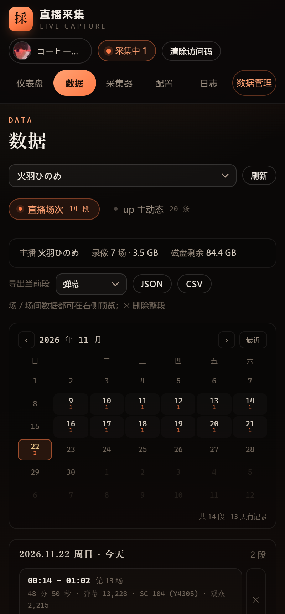

日历上每一天标着当天几段，选日期 → 下方列出当天场次（直播间场次与「场间」分开算）。顶部能切 `直播场次` / `up 主动态` 两个标签，右侧按当前段导出 JSON / CSV。

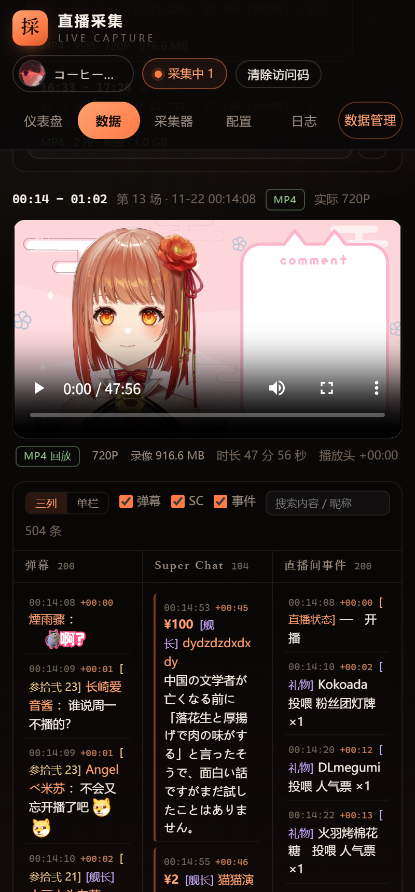

选中一场就是回放台：MP4 播放器 + 三列并排的弹幕 / Super Chat / 直播间事件，按时间轴对齐。点某条消息可以跳到对应画面；只看某一列就取消另外两列的勾选。

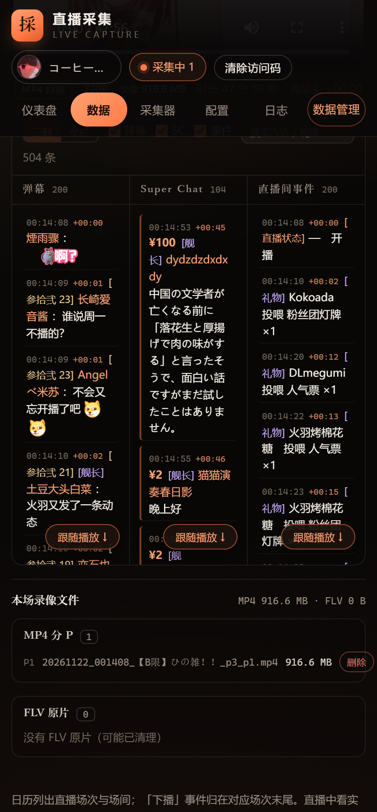

播放器下方是本场录像文件：MP4 分 P 与 FLV 原片分开列，各自能单独删。分 P 是定稿产物，FLV 原片只作留档。

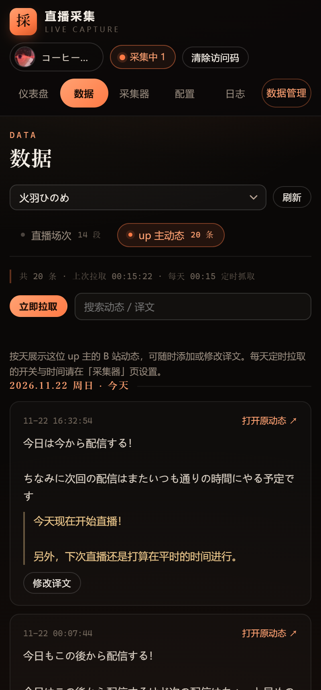

同一个页面的第二个标签：这位 up 主的 B 站动态，原文 + 译文，可手动抓取、按关键词搜、单独改译文。定时抓取的开关和时间在采集器页按 up 主分别设置。

### 采集器

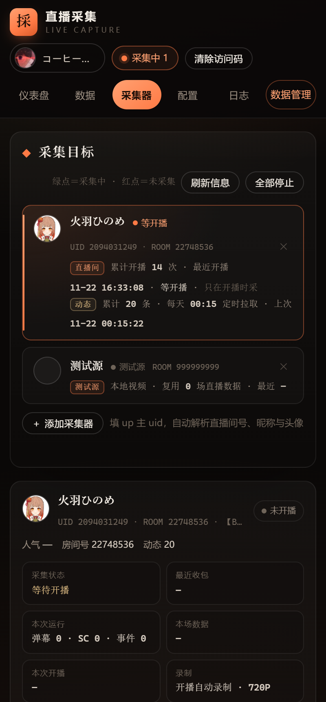

采集目标列表，绿点=采集中，红点=未采集。每个房间显示 UID / 房间号、累计开播与最近开播、动态条数与下次抓取时间；点开是这一间的实时统计（本次运行收了多少弹幕 / SC / 事件）与采集开关。

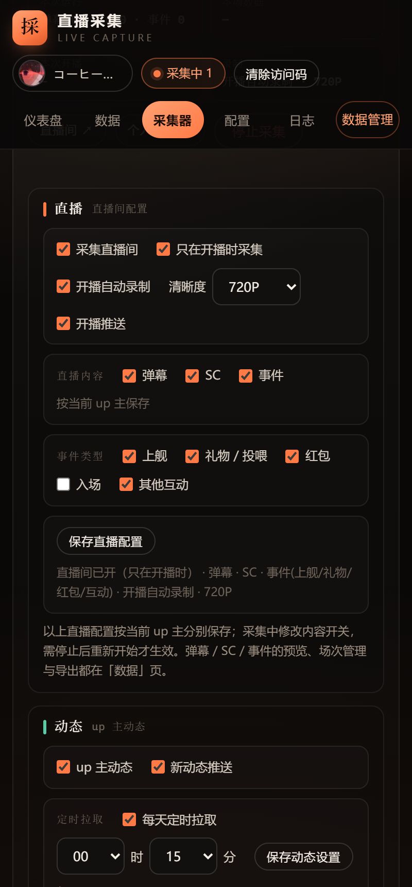

直播配置按 up 主保存：采不采直播间、只开播时采、开播自动录制与清晰度、开播推送，以及弹幕 / SC / 事件和事件类型（上舰、礼物、红包、入场、互动）逐项勾选。改完要点保存，且要停止再重新开始采集才生效。

### 配置

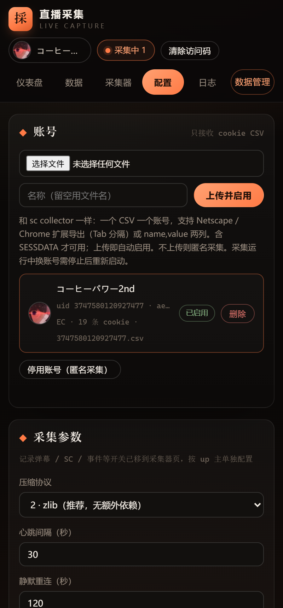

账号池只收 cookie CSV（Netscape 或扩展导出都行），对外只回 SESSDATA 掩码；下面是采集参数：压缩协议、心跳间隔、静默重连、监听地址与端口、访问口令。

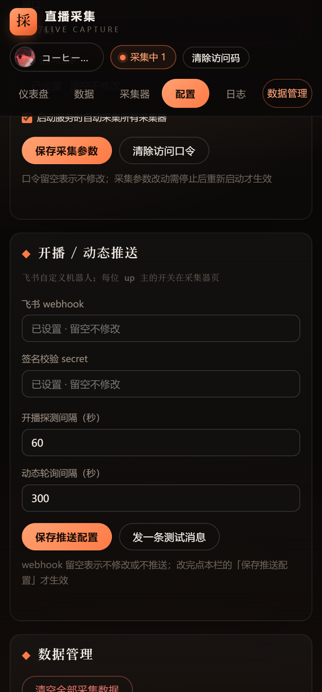

开播 / 新动态推送用飞书自定义机器人：填 webhook（可选签名 secret）、开播探测与动态轮询的间隔，改完可以「发一条测试消息」验证。每个 up 主的推送开关在采集器页单独勾。

### 日志

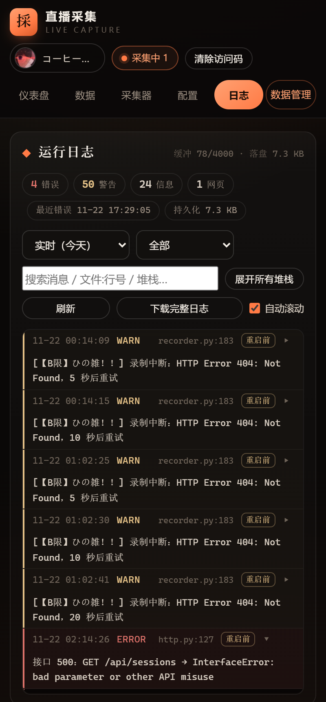

日志按级别计数，每条带来源文件与行号；重启前的告警会保留下来并标注。可以按级别、关键词、时间筛选，也能下载完整日志。

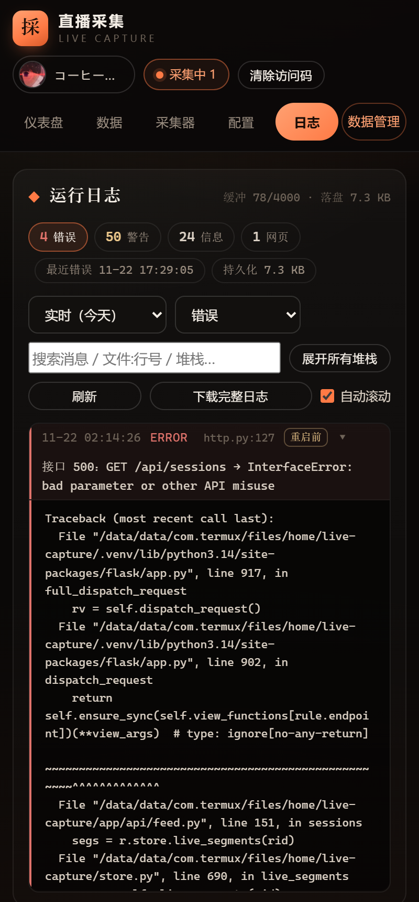

错误默认展开完整 traceback，「复制这条（含堆栈）」直接拿去排查；页面上还有线程清单、磁盘、DB+WAL、RSS、ffmpeg 可用性这些运行时信息。

## 文档索引

| 文档 | 内容 |
|---|---|
| [architecture.md](architecture.md) | 进程 / 线程模型、模块分工、一条弹幕的完整路径 |
| [api.md](api.md) | 全部 HTTP 路由、鉴权方式、分页与参数语义 |
| [data-model.md](data-model.md) | SQLite 五张表、场次（场 / 场间 / 未分段）切分口径、迁移规则 |
| [operations.md](operations.md) | 部署到手机、更新发布、SSH 接入、灭屏保活、故障恢复 |
| [development.md](development.md) | 本地开发、三套测试、前端构建、改代码的约定 |
| [pitfalls.md](pitfalls.md) | 踩坑积累：B 站接口怪癖、Android 限制、工具链坑、历史 bug 复盘 |

## 开播 / 动态推送

推送是**服务内的一个常驻线程**（`app/notifier.py`），和采集、定时抓动态互不影响：

1. 飞书群 → 设置 → 群机器人 → 添加「自定义机器人」，复制 webhook；
   开了「签名校验」的，把 secret 一起记下来。
2. 网页「配置」页 → 开播 / 动态推送 → 填 webhook（和 secret）→ 保存 → 「发一条测试消息」。
3. 网页「采集器」页 → 选中 up 主 → 直播区勾「开播推送」、动态区勾「新动态推送」。
   webhook 为空时全站不推送；单条采集器也可以单独关。

判重口径：开播按 B 站这一场的 `live_time`，动态按 `pub_ts`，第一次见到的
只记基线不推，所以服务重启不会把正在播的场次和历史动态重推一遍。
状态存 `data/notify-state.json`（删掉它就等于重新建立基线）。

开播探测走 `getInfoByRoom`（`live_start_time` 是 epoch，能和采集线程的口径对上），
匿名即可；**动态接口对匿名请求常返回 code=0 但空列表**，所以动态推送需要在
配置页放一个 B 站账号（采集器本来也要用它防 412）。拿不到数据时日志会写
「拉取动态返回 0 条」，不会静默失败。

## 快速上手（AI 助手视角）

1. **改后端**：业务逻辑在 `store.py / capture.py / rooms.py / accounts.py / dynamics.py`，HTTP 层在 `app/`（Flask 蓝图）。改完必跑 `python selftest.py` + `python tests/test_flask_api.py`。
2. **改前端**：源码在 `frontend/`（Vite + Vue 3 + TS），构建产物输出 `web/dist/` 并入库。改完必跑 `node --check` 相关脚本 + CDP 界面检查。
3. **发布到手机**：scp 推文件 → 重启服务 → health 验证。详见 operations.md 与 `.skills/deploy-termux/`。
4. **排障**：先看 `data/service.log`（手机端）与 pitfalls.md 的历史案例。

## 一句话口径

- 数据只增不删（除非用场次删除接口）；服务重启自动恢复采集（`auto_start=true`）；
- 弹幕只按场次看，没有整库视图；采集器（up 主）级配置优先于全局；
- 线上以手机 Termux 里的部署目录为准，adb 只在 ssh 不可用时兜底。
